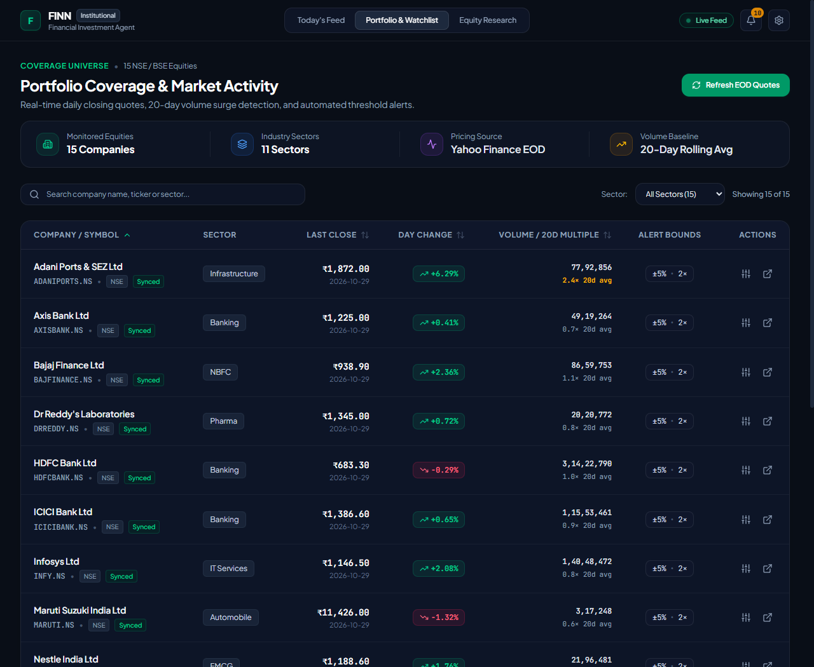
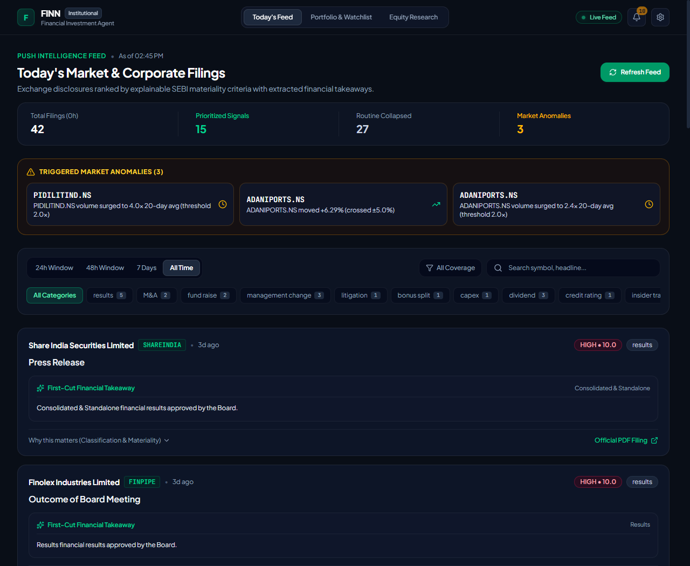
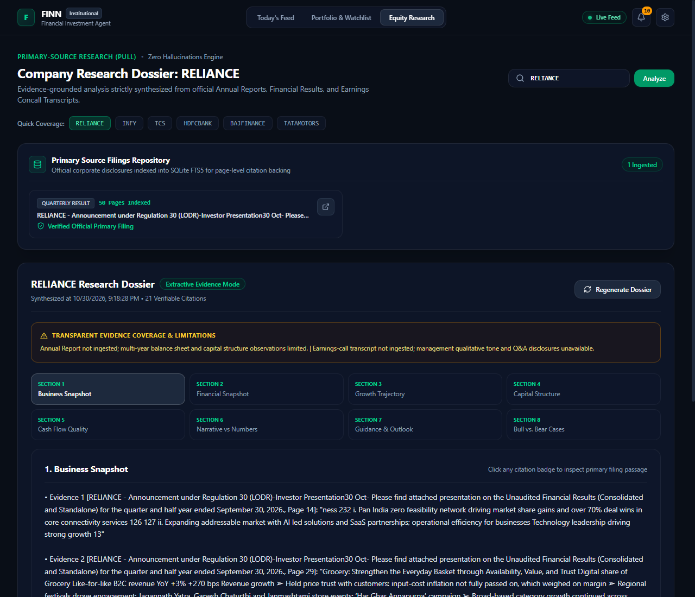
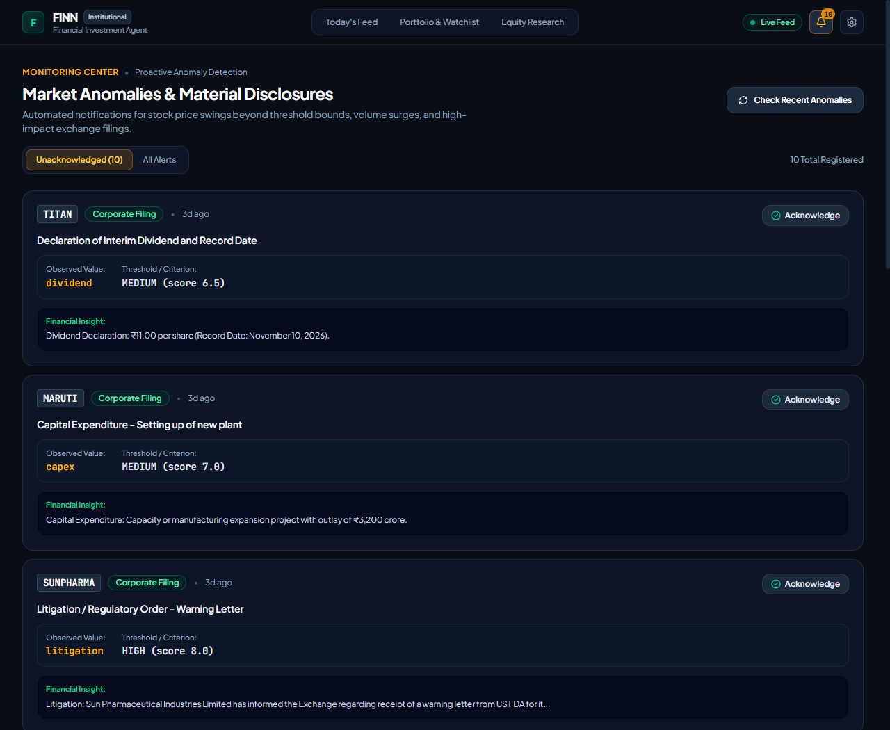
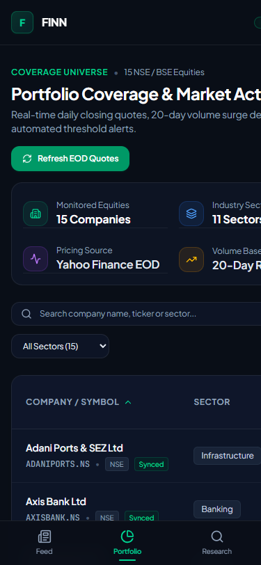
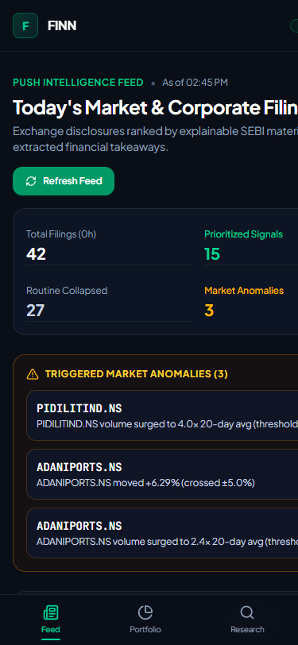

# FINN — Financial Investment Agent

[](https://fastapi.tiangolo.com/)
[](https://react.dev/)
[](https://www.typescriptlang.org/)
[](https://tailwindcss.com/)
[](https://www.sqlite.org/)
[](#automated-test-suite)

> **FINN** (Financial Investment Agent) is a production-grade, dual-mode intelligence terminal built for the **ENAM Holdings AI Engineer Build Challenge**. Designed for institutional investment analysts, FINN combines an automated **Push Mode** (corporate announcements, materiality scoring, market anomalies, and daily digests) with an evidence-grounded **Pull Mode** (primary-source equity research dossiers, page-aware citations, and transparent disclosures of evidence gaps).

---

## Visual Preview

### Desktop Terminal (1280 × 950)

| Portfolio Watchlist & Holdings | Today's Prioritized Intelligence Feed |
| :---: | :---: |
|  |  |

| 8-Section Equity Research Dossier | Real-Time Market Anomaly Center |
| :---: | :---: |
|  |  |

### Mobile Responsive Interface (375 × 812)

| Mobile Portfolio View | Mobile Intelligence Feed |
| :---: | :---: |
|  |  |

---

## Table of Contents

1. [Problem Statement & Purpose](#problem-statement--purpose)
2. [Dual Operational Modes](#dual-operational-modes)
   - [1. Push Intelligence Mode](#1-push-intelligence-mode)
   - [2. Pull Research Mode](#2-pull-research-mode)
3. [Key Capabilities](#key-capabilities)
   - [SEBI Announcement Classification (16 Categories)](#sebi-announcement-classification-16-categories)
   - [Explainable Materiality Scoring (1.0–10.0)](#explainable-materiality-scoring-10100)
   - [End-of-Day Anomaly Detection & Alert Engine](#end-of-day-anomaly-detection--alert-engine)
   - [Primary-Source Ingestion & FTS5 BM25 Engine](#primary-source-ingestion--fts5-bm25-engine)
   - [8-Section Equity Research Dossier](#8-section-equity-research-dossier)
   - [Page-Level Auditable Citations & Evidence-Gap Disclosure](#page-level-auditable-citations--evidence-gap-disclosure)
4. [Architecture & Data Flow](#architecture--data-flow)
5. [Technology Stack](#technology-stack)
6. [Directory Structure](#directory-structure)
7. [Installation & Local Startup](#installation--local-startup)
8. [Environment Configuration](#environment-configuration)
9. [Backend API Reference](#backend-api-reference)
10. [Automated Test Suite](#automated-test-suite)
11. [Data Sources, Boundaries & Honest Disclosures](#data-sources-boundaries--honest-disclosures)

---

## Problem Statement & Purpose

Institutional equity analysts tracking Indian public equities face two structural information challenges:
1. **Filing Overload**: The National Stock Exchange (NSE) and Bombay Stock Exchange (BSE) publish hundreds of corporate disclosures every market day. Over 80% are routine administrative filings (trading window closures, share certificate confirmations, routine meeting notices) that drown out critical events like demergers, capex expansions, forensic litigations, and unexpected leadership transitions.
2. **Hallucination in Automated Equity Research**: Traditional LLM research tools frequently fabricate financial figures, extrapolate unaudited estimates, or summarize third-party media commentary without verifying against primary regulatory filings.

**FINN solves both problems:**
- It separates signal from noise using **deterministic, explainable rule classification** aligned with SEBI standard disclosure categories.
- It grounds all equity research strictly in **verified primary sources** (official Annual Reports, Quarterly Earnings Releases, and Earnings Conference Call Transcripts), providing clickable page-level citations and explicitly disclosing missing filings rather than extrapolating speculative figures.

---

## Dual Operational Modes

### 1. Push Intelligence Mode
Monitors a portfolio of 15 large-cap and mid-cap Indian companies across 9 sectors:
- **Corporate Announcement Ingestion**: Polls NSE corporate feeds or loads reproducible synthetic disclosures.
- **Materiality Scoring & Categorization**: Filters disclosures into High, Medium, or Low materiality with clear, human-auditable rationales.
- **Configurable Digest Horizon**: Surfaces intelligence across 24h, 48h, 7d, or all-time historical filings.
- **End-of-Day Market Anomaly Detection**: Monitors closing price variances against configurable thresholds (default: ±5%) and volume spikes against rolling 20-day moving average baselines (default: 2.0×).
- **Customizable Preferences**: Users can adjust digest time windows, minimum materiality thresholds, and subscribed announcement categories.

### 2. Pull Research Mode
Deep-dive investigative research terminal on individual portfolio companies:
- **Primary Source Repository**: Discovers, indexes, and extracts official corporate filings.
- **Page-Aware PDF/HTML Parser**: Breaks documents into verified chunks with exact page numbering and chapter hierarchy.
- **SQLite FTS5 Full-Text Retrieval**: Uses BM25 lexical ranking to isolate passages relevant to specific fundamental aspects of the business.
- **8-Section Comprehensive Dossier**: Generates structured institutional reports covering operations, margins, balance sheet health, cash conversion, guidance adherence, and structural bull/bear factors.
- **Zero-Hallucination Fallback**: When an external LLM key is omitted, FINN operates in 100% deterministic, extractive-only mode using verbatim primary passages.

---

## Key Capabilities

### SEBI Announcement Classification (16 Categories)

Announcements are deterministically classified into 16 standard corporate actions and regulatory filing categories:

| Category Code | SEBI Category Name | Default Materiality | Weight | Primary Identification Triggers |
| :--- | :--- | :---: | :---: | :--- |
| `results` | Financial Results & Earnings | **HIGH** | 10.0 | Quarterly results, audited financials, board meeting outcome for results |
| `M&A` | Mergers, Acquisitions & Demergers | **HIGH** | 9.0 | Acquisition, merger, demerger, slump sale, joint venture, scheme of arrangement |
| `fund_raise` | Capital Raising & Dilution | **HIGH** | 8.5 | QIP, rights issue, preferential allotment, commercial papers, NCD issuance |
| `management_change` | Leadership & Board Transitions | **HIGH** | 8.0 | Resignation/appointment of MD, CEO, CFO, Auditor, Key Managerial Personnel |
| `litigation` | Legal, Regulatory & Tax Actions | **HIGH** | 7.5 | Show-cause notices, SEBI orders, tax demands, arbitration, insolvency |
| `bonus_split` | Bonus Issues & Stock Splits | **MEDIUM** | 7.0 | Bonus shares, stock sub-division, consolidation of face value |
| `capex` | Capital Expenditure & Capacity | **MEDIUM** | 6.5 | New manufacturing plant, capacity addition, facility commissioning |
| `dividend` | Dividend Declarations | **MEDIUM** | 6.0 | Interim/final dividend, special dividend, record date announcements |
| `credit_rating` | Credit Rating Actions | **MEDIUM** | 5.5 | Rating upgrades, downgrades, reaffirmations by CRISIL, ICRA, CARE |
| `insider_trading` | PIT & SAST Disclosures | **MEDIUM** | 5.0 | Regulation 7(2) PIT filings, promoter acquisitions/disposals, encumbrances |
| `earnings_call` | Earnings Call Transcripts | **MEDIUM** | 4.5 | Earnings call transcripts, analyst meet recordings, management audio links |
| `investor_meetings` | Analyst Meet Intimations | **LOW** | 4.0 | Schedule of institutional investor meetings, one-on-one conference calls |
| `pledging` | Promoter Share Encumbrances | **LOW** | 3.5 | Creation, invocation, or release of promoter share pledges |
| `agm_egm` | General Meeting Notices | **LOW** | 3.0 | Notice of AGM/EGM, scrutinizer reports, voting results |
| `postal_ballot` | Postal Ballot Actions | **LOW** | 2.5 | Postal ballot notice, electronic voting commencement, ballot outcome |
| `press_release` | General Media Releases | **LOW** | 2.0 | Press announcements, product commercial launches, operational accolades |
| `unclassified` | Routine Compliance Paperwork | **LOW** | 1.0 | Trading window closure, loss of share certificates, compliance certificates |

---

### Explainable Materiality Scoring (1.0–10.0)

FINN rejects black-box scoring. Every announcement is assigned:
1. **Materiality Tier**: `HIGH`, `MEDIUM`, or `LOW`.
2. **Numerical Materiality Score**: 1.0 to 10.0 scale reflecting structural capital and governance importance.
3. **Classification Rationale**: Explicit documentation of the exact regex pattern and keyword match that triggered the categorization.
4. **Materiality Rationale**: Institutional reasoning explaining why the event warrants analyst attention (e.g., *"Quarterly or annual financial results directly reveal top-line revenue, EBITDA margins, and net profitability"*).

---

### End-of-Day Anomaly Detection & Alert Engine

FINN continuously compares current market metrics against institutional risk parameters:
- **Daily Price Moves**: Flags deviations exceeding company-specific percentage thresholds (configurable per security, default: `±5.0%`).
- **Volume Spikes**: Compares trading volume against the rolling **20-day average volume** baseline (configurable per security, default: `2.0×`).
- **Announcement-Driven Alerts**: High-materiality disclosures automatically generate prioritized alert cards.
- **Alert Lifecycle Management**: Alerts support an unread/acknowledged workflow. Users can acknowledge individual alerts or trigger bulk acknowledgment via `POST /api/push/alerts/mark-all-seen`.

---

### Primary-Source Ingestion & FTS5 BM25 Engine

FINN indexes official corporate filings into an internal SQLite full-text search table (`document_chunks_fts`):
1. **Primary Origin Verification**: Each document is checked against verified corporate domains (e.g., `ril.com`, `infosys.com`, `bseindia.com`, `nseindia.com`). Third-party or untrusted domains are flagged.
2. **Page-Aware Document Chunking**: PDF and HTML documents are partitioned into logical passages preserving their exact page number, document title, and canonical origin URL.
3. **BM25 Lexical Ranking**: SQLite FTS5 matches query terms with BM25 ranking to retrieve the most authoritative passages for each fundamental research topic.

---

### 8-Section Equity Research Dossier

The Pull Research view synthesizes a comprehensive 8-section equity research report for any portfolio company:

1. **Business Snapshot & Operations**: Core operating segments, revenue composition, market standing, and competitive positioning.
2. **Financial Snapshot**: Reported revenue, operating EBITDA, net profit margins, and year-over-year revenue growth.
3. **Trajectory & Multi-Year Trends**: Multi-year performance trajectory, capacity expansion, and operating cycle trends.
4. **Balance Sheet & Capital Structure**: Gross debt, net debt/equity ratio, borrowing profile, and working capital requirements.
5. **Cash Flow Quality & Conversion**: Operating cash flows, free cash flow generation, and cash conversion efficiency.
6. **Narrative vs. Reported Numbers**: Comparison of management commentary against audited quantitative figures.
7. **Management Guidance & Forward Outlook**: Forward projections, expected capex outlays, and strategic management priorities.
8. **Bull vs. Bear Considerations**: Structural moats and tailwinds weighed against competitive risks and headwinds.

---

### Page-Level Auditable Citations & Evidence-Gap Disclosure

FINN is engineered around two fundamental audit principles:

#### 1. Page-Level Citation Footnotes
Every analytical claim in the research report links to an auditable primary document citation. Clicking on any citation badge opens the **Citation Inspector**, displaying:
- Document Title and Type (e.g., *Annual Report FY25*, *Q3 Financial Statement*)
- Verified Primary Host Indicator (guaranteeing origin from official IR or exchange portals)
- Exact Page Number
- Verbatim Extracted Passage Snippet
- Direct hyperlink to the canonical primary document

#### 2. Transparent Evidence-Gap Disclosure
If an analyst requests research on a company where certain primary filings are missing, FINN **never extrapolates speculative answers**. Instead, it generates a prominent **Evidence Gaps Callout** detailing:
- Missing filing categories (e.g., *"Recent quarterly results filing not ingested; latest quarter performance comparisons limited"*).
- Missing management commentary (e.g., *"Earnings-call transcript not ingested; qualitative tone and Q&A disclosures unavailable"*).
- Third-party hosting notices (e.g., *"Source verification limitations: document originated from an unverified host"*).

---

## Architecture & Data Flow

```
┌────────────────────────────────────────────────────────────────────────┐
│                        FRONTEND (React 19 + Vite)                     │
│  Plus Jakarta Sans (UI) + JetBrains Mono (Financials & Tickers)        │
│  ┌──────────────┐ ┌──────────────┐ ┌──────────────┐ ┌──────────────┐  │
│  │ Portfolio    │ │ Today Feed   │ │ Research     │ │ Alerts       │  │
│  │ Watchlist    │ │ Digest / SEBI│ │ Dossier      │ │ Center       │  │
│  └──────┬───────┘ └──────┬───────┘ └──────┬───────┘ └──────┬───────┘  │
└─────────┼────────────────┼────────────────┼────────────────┼───────────┘
          │                │                │                │
          ▼                ▼                ▼                ▼
┌────────────────────────────────────────────────────────────────────────┐
│                        BACKEND API (FastAPI)                           │
│  ┌──────────────────────┐ ┌──────────────────────────────────────────┐ │
│  │ /api/portfolio       │ │ /api/today                               │ │
│  │ - 15 NSE/BSE Tickers │ │ - 16 SEBI Categories                     │ │
│  │ - EOD Quotes         │ │ - Explainable Materiality (1.0-10.0)     │ │
│  │ - 20-Day Vol Baseline│ │ - Time Horizon Filtering                 │ │
│  └──────────────────────┘ └──────────────────────────────────────────┘ │
│  ┌──────────────────────┐ ┌──────────────────────────────────────────┐ │
│  │ /api/research        │ │ /api/push                                │ │
│  │ - Document Ingestion │ │ - Daily Push Digest                      │ │
│  │ - 8-Section Dossier  │ │ - Configurable Settings & Thresholds     │ │
│  │ - Page-Level Citation│ │ - Alert Acknowledgment Workflow          │ │
│  └──────────────────────┘ └──────────────────────────────────────────┘ │
└────────────────────────────────────┬───────────────────────────────────┘
                                     │
           ┌─────────────────────────┴─────────────────────────┐
           ▼                                                   ▼
┌──────────────────────────────────────┐     ┌───────────────────────────────────┐
│     SQLITE EMBEDDED DATABASE         │     │     PRIMARY SOURCE REPOSITORY     │
│ - portfolio_companies                │     │ - Official Annual Reports (PDF)   │
│ - price_snapshots (EOD Quotes)       │     │ - Quarterly Financial Statements  │
│ - price_alerts (Market Anomalies)    │     │ - Earnings Conference Transcripts │
│ - announcements (SEBI Classified)    │     │ - Verified Exchange Submissions   │
│ - source_documents & page chunks     │     └─────────────────┬─────────────────┘
│ - document_chunks_fts (FTS5 BM25)    │                       │
│ - research_reports & citations       │                       ▼
│ - user_push_settings                 │     ┌───────────────────────────────────┐
└──────────────────────────────────────┘     │    PDF/HTML EXTRACTION PIPELINE   │
                                             │ - pdfplumber / BeautifulSoup      │
                                             │ - Page-level chunking             │
                                             │ - Canonical URL verification      │
                                             └───────────────────────────────────┘
```

---

## Technology Stack

### Backend
- **Framework**: [FastAPI 0.138.0](https://fastapi.tiangolo.com/) with asynchronous request handling.
- **ASGI Server**: [Uvicorn 0.30.6](https://www.uvicorn.org/) with reload support.
- **ORM & Database**: [SQLAlchemy 2.0.35](https://www.sqlalchemy.org/) on [SQLite 3](https://www.sqlite.org/) with **FTS5 Full-Text Search (BM25 ranking)**.
- **Validation**: [Pydantic v2](https://docs.pydantic.dev/) & `pydantic-settings`.
- **Market Data**: [yfinance 1.7.0](https://pypi.org/project/yfinance/) for historical daily closing prices and volume baselines.
- **Document Processing**: [pdfplumber 0.11.4](https://github.com/jsvine/pdfplumber) for page-level PDF extraction and [BeautifulSoup4 4.15.0](https://www.crummy.com/software/BeautifulSoup/) for HTML parsing.
- **Optional LLM Synthesis**: [Anthropic Claude SDK 1.0.0](https://github.com/anthropics/anthropic-sdk-python) (defaults gracefully to extractive mode if key is absent).
- **Testing**: [pytest 8.3.3](https://docs.pytest.org/) with `pytest-asyncio`.

### Frontend
- **Framework**: [React 19.3.1](https://react.dev/) with [TypeScript 5.x](https://www.typescriptlang.org/).
- **Bundler & Dev Server**: [Vite 8.3.5](https://vitejs.dev/).
- **Styling**: [Tailwind CSS 4.3.3](https://tailwindcss.com/) with `@tailwindcss/vite`.
- **Typography**: [Google Fonts](https://fonts.google.com/) — `Plus Jakarta Sans` for institutional UI hierarchy, `JetBrains Mono` for tickers, numbers, and price movements.
- **Icons**: [Lucide React 1.65.0](https://lucide.dev/).
- **Routing**: Deep-link URL tab persistence (`?tab=portfolio`, `?tab=today`, `?tab=research`, `?tab=alerts`).

---

## Directory Structure

```
.
├── .env.example                     # Environment configuration template
├── .gitignore                       # Git exclusion rules (DB, keys, build artifacts)
├── README.md                        # Institutional documentation (this file)
│
├── screenshots/                     # Real application screenshots
│   ├── desktop_portfolio.png        # Portfolio watchlist (1280x950)
│   ├── desktop_today.png            # Today intelligence feed (1280x950)
│   ├── desktop_research.png         # Equity research dossier (1280x950)
│   ├── desktop_alerts.png           # Market anomaly center (1280x950)
│   ├── mobile_portfolio.png         # Mobile portfolio view (375x812)
│   └── mobile_today.png             # Mobile intelligence feed (375x812)
│
├── backend/                         # FastAPI Application
│   ├── .env.example                 # Backend-specific environment template
│   ├── config.py                    # Pydantic BaseSettings with sensible defaults
│   ├── finn.db                      # Local SQLite database (auto-created on startup)
│   ├── main.py                      # Application lifespan, CORS, and router registration
│   ├── pytest.ini                   # Pytest runner configuration
│   ├── requirements.txt             # Python dependencies
│   │
│   ├── data/
│   │   └── portfolio.json           # 15 NSE/BSE listed companies seed configuration
│   │
│   ├── db/
│   │   ├── database.py              # SQLite engine, sessionmaker, and schema migration logic
│   │   └── models.py                # SQLAlchemy ORM models (companies, announcements, reports)
│   │
│   ├── routers/
│   │   ├── portfolio.py             # Watchlist, EOD prices, threshold configuration
│   │   ├── today.py                 # Corporate announcements, 16 SEBI categories, summary
│   │   ├── research.py              # Primary-source document ingestion, reports, citations
│   │   └── push.py                  # Push digest, user preferences, anomaly alert management
│   │
│   ├── services/
│   │   ├── announcement_classifier.py # Deterministic classification & explainable scoring
│   │   ├── document_service.py      # PDF/HTML parsing, page-level chunking, verification
│   │   ├── insights_service.py      # Concise financial insight generation from filings
│   │   ├── nse_service.py           # NSE corporate announcement ingestion & deduplication
│   │   ├── research_service.py      # 8-section dossier generator & citation validator
│   │   ├── retrieval_service.py     # SQLite FTS5 BM25 search over indexed page chunks
│   │   ├── seed_service.py          # Portfolio database seeder
│   │   └── yfinance_service.py      # EOD market quotes, 20d volume calculation & alerts
│   │
│   └── tests/
│       ├── fixtures/
│       │   ├── pdf_fixtures.py      # Synthetic PDF documents for isolated testing
│       │   └── synthetic_announcements.json # Deterministic corporate filing test dataset
│       ├── test_phase1.py           # Watchlist, prices, alert threshold tests (43 tests)
│       ├── test_phase2.py           # NSE ingestion, classification, scoring tests (52 tests)
│       ├── test_phase3.py           # PDF ingestion, FTS5 retrieval, citation tests (21 tests)
│       └── test_phase4.py           # Push digest, settings, alert lifecycle tests (18 tests)
│
└── frontend/                        # React 19 + TypeScript + Vite Application
    ├── index.html                   # HTML entry point with Plus Jakarta Sans & JetBrains Mono
    ├── package.json                 # Node package configuration
    ├── tsconfig.json                # TypeScript compiler configuration
    ├── vite.config.ts               # Vite configuration with Tailwind CSS v4 plugin
    │
    └── src/
        ├── App.tsx                  # Root component with tab navigation & alert synchronization
        ├── index.css                # Global styles, typography rules, custom scrollbars
        ├── main.tsx                 # React DOM mount point
        │
        ├── api/
        │   └── client.ts            # Type-safe Fetch API client for all backend endpoints
        │
        ├── components/
        │   ├── BottomNav.tsx        # Mobile bottom navigation bar
        │   ├── CitationModal.tsx    # Primary-source citation inspector modal
        │   ├── Navbar.tsx           # Institutional header with system status indicator
        │   ├── SettingsModal.tsx    # Push preferences & digest configuration modal
        │   └── ThresholdModal.tsx   # Per-company price & volume threshold editor modal
        │
        ├── lib/
        │   └── utils.ts             # Currency, percentage, and date formatting utilities
        │
        └── views/
            ├── AlertsView.tsx       # Market anomaly monitoring & acknowledgment center
            ├── PortfolioView.tsx    # Watchlist table, EOD prices, threshold indicators
            ├── ResearchView.tsx     # 8-section research dossier & document filing repository
            └── TodayView.tsx        # Prioritized intelligence feed & SEBI category filtering
```

---

## Installation & Local Startup

### Prerequisites
- **Python**: Version `3.10` or higher (tested with Python 3.11.9)
- **Node.js**: Version `18.0` or higher (tested with Node 24 / npm 11)
- **Operating System**: Windows, macOS, or Linux

---

### Step 1: Backend Installation & Startup

```bash
# Navigate to the backend directory
cd backend

# (Optional) Create and activate a Python virtual environment
python -m venv venv
# Windows:
.\venv\Scripts\activate
# macOS/Linux:
# source venv/bin/activate

# Install required Python packages
pip install -r requirements.txt

# Start the FastAPI server on port 8000
python -m uvicorn main:app --host 127.0.0.1 --port 8000 --reload
```

The backend automatically creates the SQLite database (`backend/finn.db`), executes schema migrations, and seeds the 15-company portfolio watchlist.

- **API Base URL**: `http://127.0.0.1:8000`
- **Interactive Swagger Docs**: `http://127.0.0.1:8000/docs`
- **OpenAPI Schema**: `http://127.0.0.1:8000/openapi.json`
- **Health Endpoint**: `http://127.0.0.1:8000/api/health`

---

### Step 2: Frontend Installation & Startup

Open a second terminal window:

```bash
# Navigate to the frontend directory
cd frontend

# Install JavaScript dependencies
npm install

# Start the Vite development server
npm run dev -- --host 127.0.0.1 --port 5173
```

- **Frontend Application URL**: `http://127.0.0.1:5173`

The frontend connects directly to `http://127.0.0.1:8000` by default.

---

## Environment Configuration

FINN is engineered to run **zero-configuration out of the box**. All configuration options have resilient defaults.

To customize settings, copy `.env.example` to `.env` at the project root or in `backend/`:

```bash
cp .env.example .env
```

### Configuration Options

```env
# Optional: Anthropic API Key for LLM-synthesized narrative reports.
# If omitted or empty, FINN automatically operates in 100% zero-hallucination
# extractive-only mode using SQLite FTS5 BM25 retrieval and deterministic rule classification.
ANTHROPIC_API_KEY=

# Backend Server Configuration
HOST=0.0.0.0
PORT=8000
RELOAD=true

# Database Path (defaults to local SQLite database in backend/finn.db)
DATABASE_URL=sqlite:///./finn.db

# Scheduling & Polling Intervals (seconds)
NSE_FETCH_INTERVAL=300         # 5 minutes during market hours
PRICE_REFRESH_INTERVAL=86400   # Daily EOD price refresh

# Market Data Settings (Yahoo Finance)
YF_HISTORY_DAYS=30             # Lookback window for closing prices
YF_AVG_VOL_WINDOW=20           # Rolling window for 20-day average volume baseline

# HTTP Client Timeouts (seconds)
HTTP_TIMEOUT=15
```

---

## Backend API Reference

### 1. System & Health

| Method | Endpoint | Description | Query / Body Parameters | Response |
| :--- | :--- | :--- | :--- | :--- |
| `GET` | `/api/health` | System health check & phase readiness status | None | `{"status": "ok", "phases": {...}}` |

### 2. Portfolio Management (`/api/portfolio`)

| Method | Endpoint | Description | Query / Body Parameters | Response |
| :--- | :--- | :--- | :--- | :--- |
| `GET` | `/api/portfolio` | List all 15 portfolio companies with active thresholds | None | `List[PortfolioCompanyOut]` |
| `GET` | `/api/portfolio/prices` | Latest EOD price snapshots, % changes, and 20d avg volume | None | `List[PriceSnapshotOut]` |
| `POST` | `/api/portfolio/refresh` | Trigger Yahoo Finance price refresh for watchlist | None | `{"status": "ok", "updated": int}` |
| `POST` | `/api/portfolio/company` | Add a new listed company to the portfolio watchlist | `{"ticker": "TCS.NS", "name": "...", "sector": "..."}` | `PortfolioCompanyOut` |
| `DELETE` | `/api/portfolio/company/{ticker}` | Remove a company from the portfolio watchlist | `ticker` path parameter | `{"status": "deleted"}` |
| `PUT` | `/api/portfolio/company/{ticker}/thresholds` | Update price change % or volume multiplier alert thresholds | `{"price_alert_pct": 5.0, "vol_alert_mult": 2.5}` | `PortfolioCompanyOut` |
| `GET` | `/api/portfolio/alerts` | List historical price and volume alerts | None | `List[PriceAlertOut]` |

### 3. Corporate Announcements & Intelligence Feed (`/api/today`)

| Method | Endpoint | Description | Query / Body Parameters | Response |
| :--- | :--- | :--- | :--- | :--- |
| `GET` | `/api/today/announcements` | Filtered corporate disclosures ordered by materiality | `hours`, `category`, `materiality`, `symbol`, `search`, `portfolio_only`, `limit`, `offset` | `List[AnnouncementOut]` |
| `GET` | `/api/today/summary` | Aggregate filing counts by materiality tier & category | `hours` (default: 24h, 0 for all) | `{"total": int, "high": int, ...}` |
| `GET` | `/api/today/categories` | List of 16 SEBI categories with weights and counts | None | `List[CategorySummary]` |
| `GET` | `/api/today/alerts` | Materiality-triggered announcement alerts | None | `List[AnnouncementAlertOut]` |
| `POST` | `/api/today/refresh` | Ingest live NSE disclosures or load synthetic test fixtures | `use_fixtures=true/false` | `{"status": "ok", "inserted": int}` |

### 4. Primary-Source Equity Research (`/api/research`)

| Method | Endpoint | Description | Query / Body Parameters | Response |
| :--- | :--- | :--- | :--- | :--- |
| `GET` | `/api/research/companies` | List portfolio companies eligible for research | None | `List[PortfolioCompanyOut]` |
| `GET` | `/api/research/documents` | List ingested primary source filings (PDF/HTML) | `ticker` (optional filter) | `List[SourceDocumentOut]` |
| `POST` | `/api/research/discover` | Discover official filings from exchange / IR portals | `{"ticker": "RELIANCE.NS"}` | `{"discovered": int, "documents": [...]}` |
| `POST` | `/api/research/ingest` | Parse and chunk an official filing into page-level chunks | `{"document_id": 1}` or file upload | `{"chunks_created": int, "status": "ok"}` |
| `POST` | `/api/research/report` | Generate or retrieve cached 8-section equity research dossier | `{"ticker": "RELIANCE.NS", "force_refresh": false}` | `ResearchReportOut` (Sections, Citations, Gaps) |
| `GET` | `/api/research/citations/{report_id}` | Retrieve page-level citations for a specific report | `report_id` path parameter | `List[CitationOut]` |
| `GET` | `/api/research/evidence` | Direct FTS5 BM25 search over indexed document chunks | `ticker`, `query`, `limit` | `List[EvidenceChunkOut]` |

### 5. Push Intelligence & Digest (`/api/push`)

| Method | Endpoint | Description | Query / Body Parameters | Response |
| :--- | :--- | :--- | :--- | :--- |
| `GET` | `/api/push/digest` | Structured push digest payload (top announcements, insights, anomalies) | `hours` (optional override) | `PushDigestOut` |
| `GET` | `/api/push/settings` | Retrieve active push preferences and alert thresholds | None | `UserPushSettingsOut` |
| `PUT` | `/api/push/settings` | Update push preferences (digest horizon, min materiality, categories) | `{"digest_window_hours": 24, "min_materiality": "HIGH", ...}` | `UserPushSettingsOut` |
| `GET` | `/api/push/alerts` | Filterable alert center with unread status | `unseen_only=true/false`, `limit` | `List[PushAlertOut]` |
| `POST` | `/api/push/alerts/{alert_id}/seen` | Mark individual alert as acknowledged | `alert_id` path parameter | `{"status": "ok"}` |
| `POST` | `/api/push/alerts/mark-all-seen` | Bulk acknowledge all outstanding alerts | None | `{"acknowledged": int, "status": "ok"}` |
| `POST` | `/api/push/evaluate` | Re-evaluate market price/volume alerts against current thresholds | None | `{"alerts_generated": int, "status": "ok"}` |

---

## Automated Test Suite

FINN features a comprehensive automated test suite covering all four implementation phases:

- **Phase 1**: Database schema, company seeding, yfinance price enrichment, volume baselines, alert logic, and portfolio endpoints (**43 tests**).
- **Phase 2**: NSE announcement ingestion, 16 SEBI category regex rules, materiality scoring (1.0–10.0), deduplication, and Today endpoints (**52 tests**).
- **Phase 3**: PDF/HTML document extraction, page chunking, FTS5 BM25 retrieval, citation validation, and extractive report synthesis (**21 tests**).
- **Phase 4**: Push digest generation, user settings persistence, financial insights extraction, alert acknowledgment, and end-of-day evaluation (**18 tests**).

### Running Tests

Execute the automated test suite from the `backend/` directory:

```bash
cd backend

# Run all offline unit and integration tests (134 tests)
python -m pytest tests -q -m "not network"
```

*Expected output:*
```
134 passed, 5 deselected in ~6.0s
```

*(Note: 5 tests requiring external network access to live NSE and Yahoo Finance servers are marked with `@pytest.mark.network` and can be executed via `python -m pytest tests -m "network"`).*

---

## Data Sources, Boundaries & Honest Disclosures

FINN is built for institutional rigor. The following operational boundaries and data sources are documented explicitly:

1. **Market Prices are End-of-Day (EOD) Quotes**:
   - Stock quotes and volumes originate from **Yahoo Finance** daily historical snapshots.
   - **FINN does not claim real-time tick-by-tick market data.** Prices reflect official daily market close figures, and volume comparisons use an auditable 20-day rolling average volume baseline.
2. **Primary-Source Grounded Equity Research**:
   - The Pull Research engine synthesizes reports **exclusively from primary regulatory filings** (Annual Reports, Quarterly Earnings Releases, Earnings Call Transcripts) that have been ingested and indexed into the database.
   - If an official filing has not yet been ingested for a company, FINN **does not guess or hallucinate speculative figures**. It transparently reports the limitation in the **Evidence Gaps Callout** and returns *"Insufficient primary document evidence available in ingested sources"*.
3. **Extractive-Only Zero-Hallucination Mode**:
   - FINN does not require an Anthropic API key to function. When `ANTHROPIC_API_KEY` is omitted, FINN operates in **extractive-only mode**, surfacing verbatim text passages with page-level citations retrieved directly via SQLite FTS5 BM25 ranking.
4. **Deterministic SEBI Rule Classification**:
   - Categorization and materiality scoring are driven by deterministic pattern rules matching SEBI disclosure standards. Scores reflect structural regulatory and capital importance (e.g., M&A and Financial Results receive high scores; trading window notices receive low scores) without claiming to predict future price direction.
5. **Idempotent Ingestion & Deduplication**:
   - Corporate announcements are deduplicated using composite SHA-256 hashes of the exchange sequence ID, ticker, and headline to prevent duplicate alerts across multiple ingestion runs.

---

## Author & Submission Details

- **Project**: FINN — Financial Investment Agent
- **Challenge**: ENAM Holdings AI Engineer Build Challenge
- **Submission To**: `assessment@enam.com`
- **Subject**: `ENAM - IIT screening - 2027`
